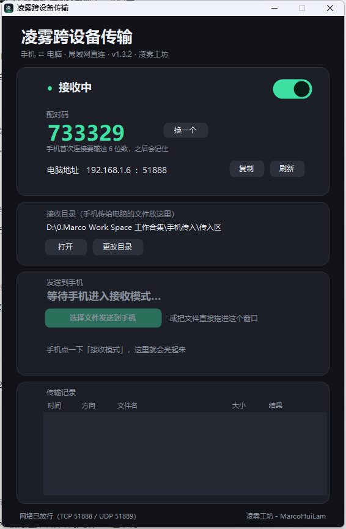
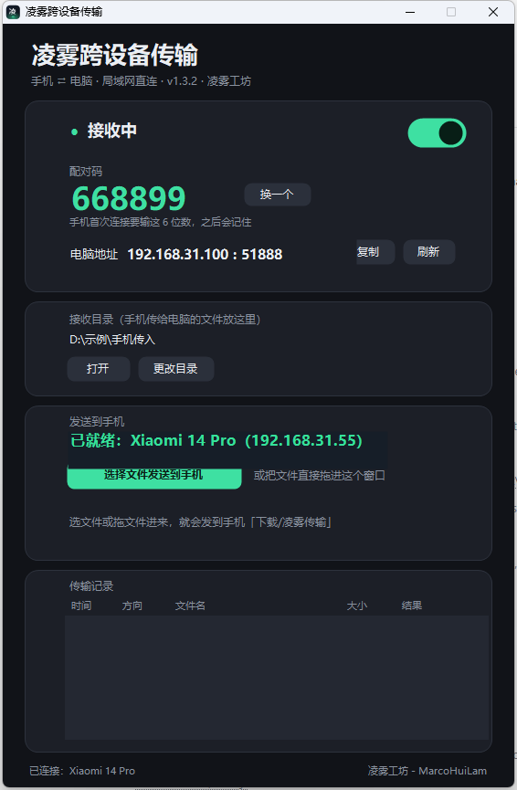

# 凌雾跨设备传输 · Lingwu Transfer

> 手机 ⇄ 电脑，同一个局域网内直接传文件。不登录、不上传、不经过任何服务器。
> Android + Windows 双端，**零第三方依赖**（无 SDK、无统计、无广告）。
**作者 / Author：凌雾工坊 - MarcoHuiLam** ｜ 源码公开 · 个人使用免费 · 商业使用需书面授权
© 2026 凌雾工坊 - MarcoHuiLam ｜ 许可证：[PolyForm Noncommercial 1.0.0](LICENSE)



---

## 这是什么

一个"单功能、轻量、自己可控"的局域网文件传输工具：

- **手机 → 电脑**：手机上多选图片/视频，直接落到电脑指定文件夹（可配合自动归档脚本）
- **电脑 → 手机**：手机点一下「接收模式」，电脑上点按钮或**把文件拖进窗口**，手机自动保存到 `下载/凌雾传输`
- 两端各一个程序：Windows 免安装 exe（约 400 KB）+ Android APK（约 77 KB）

**为什么不用网盘/微信**：不走互联网、不压缩、不改画质、不限速，也不把你的文件经过第三方。

---

## 功能

| | |
|---|---|
| 自动发现 | 同网段广播 + **跨网段单播探测**（应对"手机在 192.168.31.x、电脑在 192.168.1.x"这类两级路由） |
| 配对码 | 6 位数字，两个方向都要，错码明确拒绝 |
| 历史设备 | 记住连过的电脑，下次打开自动重连、一键连接；配对码变了会提示重输 |
| 双向传输 | 手机→电脑、电脑→手机；两边都有进度 |
| 接收开关 | 电脑端可一键暂停接收；关闭即断开 |
| 不覆盖 | 同名文件自动改名 `名字 (2).xxx` |
| 断点安全 | 先写临时文件 `.lwpart_`，收完才改名，不留半截文件 |
| 中文文件名 | 全链路 UTF-8 |

---

## 平台要求

- **Windows**：Windows 10 / 11（.NET Framework 4.8 系统自带，无需安装运行时）
- **Android**：7.0 及以上（minSdk 24，targetSdk 34）；保存到 `下载/凌雾传输`
  - Android 10+ 走 MediaStore，**不需要存储权限**
  - Android 7-9 首次接收会请求一次存储权限

---

## 下载安装

到本仓库的 **Releases** 页面下载：

- `凌雾跨设备传输.exe` — 免安装，双击即用
- `凌雾跨设备传输.apk` — 手机安装（MIUI 需允许"未知来源"）

> 只从本仓库 Releases 下载。开源 APK 可能被第三方二次打包，请核对 Releases 里公布的 SHA-256。

---

## 使用（三步）

1. 电脑双击 exe，确认状态「接收中」，记下 6 位配对码
2. 手机打开 App：自动搜电脑 → 填一次配对码 → 之后自动记住
3. 传文件：
   - 手机→电脑：手机选文件 →「发送到电脑」
   - 电脑→手机：手机点「进入接收模式」→ 电脑点「选择文件发送到手机」或把文件拖进窗口

详细说明见 [docs/使用说明.txt](docs/使用说明.txt)。



---

## 常见问题

**Q：搜不到电脑？**
先点「深度搜索」。仍未找到时，直接在地址栏填电脑窗口上的 IP + 配对码点「测试连接」——这条永远有效。
两级路由器（手机 192.168.31.x / 电脑 192.168.1.x）属于跨网段，v1.3 起用单播探测可以自动找到；如果路由器开了访客网络隔离，仍需手动填 IP。

**Q：传输安全吗？**
不经过互联网，但要如实说明：**当前版本在局域网内是明文 TCP 传输**，同一 WiFi 下的其他设备理论上可嗅探。请只在可信网络（家里/公司内网）使用，公共 WiFi 不要传隐私文件。加密传输在路线图里。

**Q：需要 App 备案吗？**
本仓库只做开源分发，不上架国内应用商店。若要上架国内商店（小米/华为等），按工信部要求需要 App 备案 + 软件著作权，本项目不代为处理。

---

## 构建

零第三方依赖，两种产物都能从源码一键构建。

### Windows 端（exe）

```powershell
powershell -ExecutionPolicy Bypass -File build/build-pc.ps1
```

用系统自带的 .NET Framework 编译器（`csc.exe`）编译，产物在 `dist/`。

### Android 端（APK）

需要 JDK 17 + Android SDK（build-tools 34、platform 34）。不依赖 Gradle，用 aapt2 + d8 + apksigner 手工打包：

```powershell
powershell -ExecutionPolicy Bypass -File build/build-apk.ps1 `
  -JdkBin "C:\path\to\jdk-17\bin" `
  -AndroidJar "C:\path\to\platforms\android-34\android.jar" `
  -BuildTools "C:\path\to\build-tools\34.0.0"
```

> 注意：aapt2 不认非 ASCII 路径。请把仓库放在纯英文路径下构建，或自行调整脚本中的临时目录。

自行构建的 APK 用**你自己的密钥签名**，与 Releases 里的包签名不同，**不能覆盖安装**（需先卸载）。

---

## 许可证（请先读这段）

本项目采用 **[PolyForm Noncommercial License 1.0.0](LICENSE)**（SPDX：`PolyForm-Noncommercial-1.0.0`）。

- ✅ **个人使用免费**：个人学习、研究、实验、私人娱乐、爱好项目等非商业用途，可自由使用、修改、分享
- ❌ **商业用途需书面授权**：包括但不限于——公司/组织内部业务使用、付费分发、捆绑销售、SaaS 化、嵌入商业产品、以本项目提供收费服务
- 分发时必须保留本许可证与版权声明；不得使用本项目名称/图标暗示官方认可

**重要：本项目不是 OSI 定义的开源软件。** 因为带有"禁止商业使用"限制，它属于 *source-available*（源码公开）而非 open source。因此本项目**无法进入 F-Droid、Debian 等要求严格自由许可的仓库**，这是许可证选择的必然结果，不是疏漏。

商业授权请联系：`83503035@qq.com`

---

## 免责声明

- 本项目为个人独立作品，与小米、华为、Google 等任何厂商**无关联、无授权、无背书**
- 软件按"现状"提供，不提供任何明示或暗示担保；因使用造成的任何数据丢失或损失，作者不承担责任
- 请勿用于传输违法违规内容；使用者自行承担合规责任
- 请勿在公共网络传输敏感文件（见上文安全说明）

---

## 隐私

**不收集任何个人信息。** 无账号、无服务器、无第三方 SDK、无统计埋点、无崩溃上报。详见 [PRIVACY.md](PRIVACY.md)。

---

## 贡献

欢迎 Issue 与 Pull Request。提交 PR 前请注意：

- 本许可证禁止商业使用，**但作者保留向商业客户另行授权的权利**，因此 PR 需同意 [CLA.md](CLA.md)（贡献者许可协议），授权作者对你的贡献进行再许可
- 不接受引入第三方依赖、统计 SDK、广告代码的 PR（"零依赖"是本项目的核心约束）
- 安全问题请按 [SECURITY.md](SECURITY.md) 私下报告，不要公开 Issue

---

## 路线图

- [ ] 传输加密（配对码派生密钥 + AES-GCM）
- [ ] Android 前台服务常驻（切后台不断连）
- [ ] 多设备并行接收
- [ ] 传输历史持久化 + 自动归档规则
